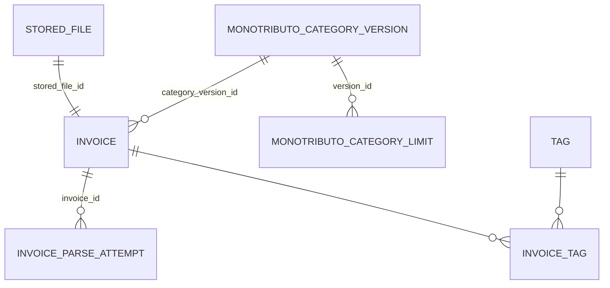

# Tevildo – Database Schema

This document describes the **concrete database schema** used by Tevildo.

It focuses on **what exists and how it connects**, not on design rationale.
For the reasoning behind these decisions, see **DATA_MODEL.md**.

---

## 1. Entity–Relationship Diagram

---

## 2. Tables

### 2.1 `stored_file`
Metadata for files stored on disk (PDFs are **not** stored in the DB).

**Purpose**
- Decouple binary storage from relational data
- Enable integrity checks and deduplication

**Key fields**
- `id` (UUID, TEXT)
- `relative_path` – path relative to app data directory
- `sha256` – integrity + deduplication
- `mime_type` – e.g. `application/pdf`
- `byte_size`
- `created_at`

---

### 2.2 `invoice`
Central business entity.
Represents one issued invoice and its immutable tax snapshot.

**Purpose**
- Reporting
- Rolling 12‑month calculations
- Audit-safe persistence

**Key fields**
- Identity & lifecycle: `id`, `status`, `uploaded_at`, `parsed_at`, `locked_at`
- Invoice identity: `invoice_type`, `point_of_sale`, `invoice_number`
- Dates: `issue_date`
- Client snapshot: `client_name`, `client_tax_id`
- Amounts: `currency`, `total_original`, `total_ars`
- FX snapshot: `fx_rate`, `fx_date`, `fx_source`
- Relations:
  - `stored_file_id`
  - `category_version_id`

**Notes**
- Once `locked_at` is set, financial fields must be treated as immutable
- FX and ARS totals are snapshots, not recomputed

---

### 2.3 `monotributo_category_version`
Represents a published Monotributo regulation/table.

**Purpose**
- Versioning of category limits
- Auditability across regulatory changes

**Key fields**
- `id` (UUID, TEXT)
- `name` – e.g. "2025-v1", "2025-v2"
- `valid_from` – ISO-8601 date when this version becomes active
- `valid_to` – ISO-8601 date when it expires (NULL if current)
- `notes` – optional description of regulatory changes
- `created_at`

---

### 2.4 `monotributo_category_limit`
Represents category limits within a given version.

**Purpose**
- Store per-category annual limits and monthly payment amounts
- Avoid duplication of version metadata
- Store all ARCA fields for completeness

**Key fields**
- `id` (UUID, TEXT)
- `version_id` (FK to monotributo_category_version)
- `category_letter` (A, B, C, D, E, F, G, H, I, J, K)
- Income limits:
  - `annual_income_limit_services` – for "Locaciones y prestaciones de servicios"
  - `annual_income_limit_goods` – for "Venta de cosas muebles"
- Physical/consumption limits:
  - `surface_limit_m2` – affected surface area
  - `electricity_limit_kwh` – annual electricity consumption
  - `annual_rent_limit_ars` – annual accrued rent
- Monthly payments (services):
  - `integrated_tax_services`
  - `pension_contribution_services`
  - `social_security_services`
- Monthly payments (goods):
  - `integrated_tax_goods`
  - `pension_contribution_goods`
  - `social_security_goods`
- `created_at`

**Constraints**
- Unique `(version_id, category_letter)`

**Notes**
- For SW developers working abroad, primarily use `annual_income_limit_services`
- All ARCA fields stored for completeness and future flexibility

---

### 2.5 `tag`
Simple tagging system.

**Purpose**
- Flexible grouping and filtering of invoices

**Key fields**
- `id`
- `name`

---

### 2.6 `invoice_tag`
Join table between invoices and tags.

**Purpose**
- Many-to-many relationship

**Key fields**
- `invoice_id`
- `tag_id`

---

### 2.7 `invoice_parse_attempt`
Audit trail of parsing attempts.

**Purpose**
- Debugging parser behavior
- Human-in-the-loop review
- Transparency and explainability

**Key fields**
- `id`
- `invoice_id`
- `created_at`
- `parser_name`
- `confidence`
- `warnings`
- `extracted_json`

---

## 3. Indexes & Constraints (high-level)

- Index on `invoice.issue_date` for time-based reports
- Index on `invoice.status` for workflow UI
- Unique constraint on invoice identity fields when present
- Foreign keys enabled (`PRAGMA foreign_keys = ON`)

---

## 4. Related documents

- **DATA_MODEL.md** – design rationale and tradeoffs
- **ARCHITECTURE.md** – overall system architecture
- **MIGRATIONS.md** (future) – schema evolution strategy

---

This file is intentionally **descriptive and mechanical**.
All reasoning and philosophy live in `DATA_MODEL.md`.

